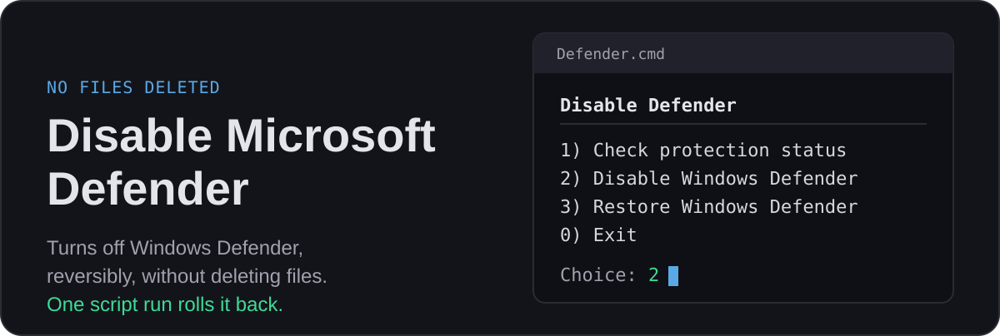
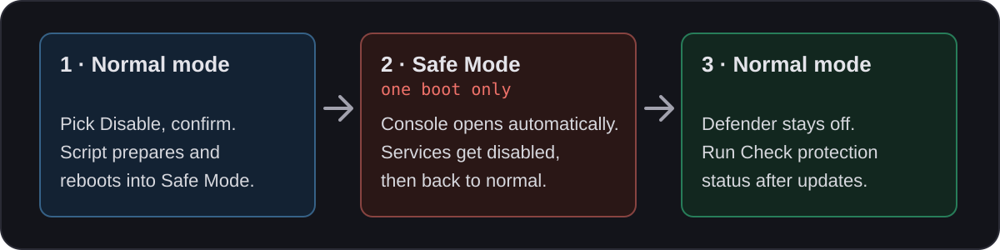

  

  English · <a href="README_RU.md">Русский</a> · <a href="https://lyverance.github.io/Disable-Defender/defender_guide.html">Manual web guide</a>

Disables Windows Defender without deleting it. The tool changes the registry (and, for SmartScreen, file permissions), needs no third-party software and can restore the saved state.

Tested on **Windows 11 IoT Enterprise 25H2 and 26H2**. Other editions and Windows 10 are not verified.

> [!CAUTION]
> Provided as is, without warranty. Use at your own risk.

## Why not Defender Remover / Killer

Those tools delete Defender components from `WinSxS`. Afterwards cumulative updates can fail with `0x800f081f`, `sfc /scannow` and `DISM` stop working or restore Defender broken, and the usual way back is reinstalling Windows. This tool deletes and replaces no Windows files, so Windows Update keeps working in the tested scenarios, and Restore reverts the changes from the saved backup.

## Quick start

Extract the entire archive and keep its folder structure intact: the `.internal` folder next to `Defender.cmd` holds the scripts and the backup that Restore uses. Double-click `Defender.cmd`; it requests administrator rights itself and opens a menu.

  

### Disable

1. Pick "Disable Windows Defender" and confirm. The PC reboots into Safe Mode.
2. Sign in with your account password.
3. A console window opens automatically, disables the services and returns the PC to normal mode.

> [!IMPORTANT]
> PIN and Windows Hello are not available in Safe Mode, so you need your account password. Safe Mode is used for this one boot only: if you cannot sign in, restart from the sign-in screen. Windows starts normally, the disabling is not finished, and you can run Disable again once you have the password.

> [!NOTE]
> Tamper Protection can stay on: Safe Mode finishes anything it blocks.

### Check

Pick "Check protection status" for a report on the Defender components.

### Restore

Pick "Restore Windows Defender" and confirm. The state saved in the backup is restored and the PC reboots. A backup made under another Windows account does not restore that account's own settings, and a backup from another installation is rejected. Without a usable backup, built-in defaults are used (see "Backup and restoration" below).

### After Windows updates

An update can undo parts of the setup: for example, Windows may take back ownership of `smartscreen.exe` or add a new Defender service. After any Windows update, run "Check protection status". If it reports a problem, run Disable again: it fixes what changed and keeps your first backup.

### Prefer not to run scripts?

The [manual web guide](https://lyverance.github.io/Disable-Defender/defender_guide.html) shows how to disable and restore Defender with commands you run yourself. Without the script's backup, manual restore returns default values, which may differ from your original settings.

## What it disables

| Component | Details |
|---|---|
| **Defender Core** | WinDefend, WdFilter, MDCoreSvc, WdBoot, WdNisSvc, WdNisDrv |
| **Telemetry** | Sense, webthreatdefsvc, webthreatdefusersvc |
| **Scheduler** | 4 Defender maintenance tasks and `RecoverabilityToastTask` |
| **Context menu** | "Scan with Microsoft Defender" |
| **SmartScreen** | Registry + `smartscreen.exe` block |
| **Notifications** | Security Center, HealthCenter |
| **Downloaded-file warning** | Not Defender: removes the "Open File - Security Warning" prompt for the current Windows account |

## Details

<b>Backup and restoration</b>

 

Keep `.internal/defender-backup.json` with the scripts: a repeat run preserves the first backup.

If the backup is missing or invalid, Restore can only apply built-in Windows defaults, not your original settings. It warns you and, for an invalid backup, asks for confirmation first.

<b>Automation: switches and exit codes</b>

 

`Defender.cmd` takes switches for scripted use:

- `/Status`, `/Disable`, `/Restore` pick the action (default: menu).
- `/Unattended` skips every prompt and takes the safe default (a detected third-party antivirus is declined, exit code `2`).
- `/AllowReboot` is required with `/Unattended` for `/Disable` and `/Restore`, since both reboot the PC; without it they are rejected before anything changes.

Exit codes: `0` completed (or an optional prompt was declined); `1` failed or found a problem; `2` rejected before any change.

Exit code `0` alone does not prove a restore: with `/Restore /Unattended`, no usable backup and active protection found, the script declines to apply defaults and still returns `0`. Without `/Unattended`, a launch without administrator rights starts an elevated copy and exits at once, so its exit code is not the result of the run.

