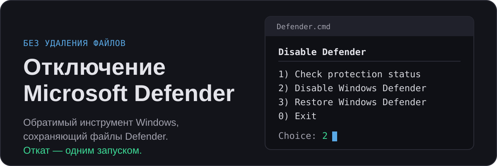
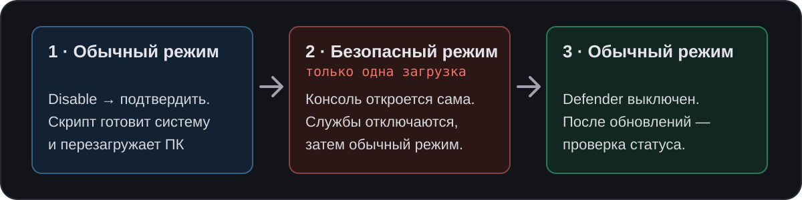

  

  <a href="README.md">English</a> · Русский · <a href="https://lyverance.github.io/Disable-Defender/defender_guide_ru.html">Ручная веб-инструкция</a>

Отключает Защитник Windows, не удаляя его. Инструмент меняет реестр (и, для SmartScreen, права на файл), не требует стороннего софта и умеет вернуть сохранённое состояние.

Проверено на **Windows 11 IoT Enterprise 25H2 и 26H2**. Другие редакции и Windows 10 не проверялись.

> [!CAUTION]
> Предоставляется как есть, без гарантий. Используйте на свой риск.

## Почему не Defender Remover / Killer

Такие утилиты удаляют компоненты Defender из `WinSxS`. После этого накопительные обновления могут падать с `0x800f081f`, `sfc /scannow` и `DISM` не работают или возвращают Defender сломанным, а путь назад обычно один — переустановка Windows. Этот инструмент не удаляет и не заменяет файлы Windows: Windows Update продолжает работать в проверенных сценариях, а восстановление возвращает изменения из сохранённой копии.

## Быстрый старт

Распакуйте архив целиком и сохраните структуру папок: `.internal` рядом с `Defender.cmd` содержит скрипты и резервную копию, из которой работает восстановление. Дважды кликните `Defender.cmd`: он сам запросит права администратора и откроет меню.

  

### Отключение

1. Выберите «Disable Windows Defender» и подтвердите. ПК перезагрузится в Безопасный режим.
2. Войдите с паролем учётной записи.
3. Консоль откроется автоматически, отключит службы и вернёт ПК в обычный режим.

> [!IMPORTANT]
> PIN-код и Windows Hello в Безопасном режиме недоступны, нужен пароль учётной записи. Безопасный режим включается только на одну загрузку: если войти не получилось, перезагрузитесь с экрана входа. Windows загрузится обычным образом, отключение не завершено, и его можно запустить снова, когда будет пароль.

> [!NOTE]
> Защиту от несанкционированного доступа (Tamper Protection) выключать не нужно: что она заблокирует, доделает Безопасный режим.

### Проверка

Выберите «Check protection status» — отчёт о состоянии компонентов Defender.

### Восстановление

Выберите «Restore Windows Defender» и подтвердите. Состояние из резервной копии вернётся, ПК перезагрузится. Копия, сделанная под другой учётной записью Windows, не вернёт настройки этой записи, а копия от другой установки отклоняется. Без пригодной копии используются встроенные значения (см. «Резервная копия и восстановление» ниже).

### После обновлений Windows

Обновление может отменить часть настроек: например, Windows может вернуть себе владельца `smartscreen.exe` или добавить новую службу Defender. После любого обновления Windows выберите «Check protection status». Если он сообщит о проблеме, запустите отключение снова: оно исправит изменившееся и сохранит первую копию.

### Не хотите запускать скрипты?

[Ручная веб-инструкция](https://lyverance.github.io/Disable-Defender/defender_guide_ru.html) показывает, как отключить и восстановить Defender командами, которые вы выполняете сами. Без копии скрипта ручное восстановление возвращает значения по умолчанию, которые могут отличаться от ваших исходных настроек.

## Что отключает скрипт

| Компонент | Что именно |
|---|---|
| **Ядро Defender** | WinDefend, WdFilter, MDCoreSvc, WdBoot, WdNisSvc, WdNisDrv |
| **Телеметрия** | Sense, webthreatdefsvc, webthreatdefusersvc |
| **Планировщик** | 4 задачи обслуживания Defender и `RecoverabilityToastTask` |
| **Контекстное меню** | «Проверить с помощью Defender» |
| **SmartScreen** | Реестр + блокировка `smartscreen.exe` |
| **Уведомления** | Security Center, HealthCenter |
| **Предупреждение о скачанных файлах** | Не Defender: убирает окно «Открыть файл — предупреждение системы безопасности» для текущей учётной записи |

## Подробности

<b>Резервная копия и восстановление</b>

 

Сохраните `.internal/defender-backup.json` вместе со скриптами: повторный запуск оставляет первую копию.

Если копии нет или она повреждена, восстановление может применить только встроенные значения Windows, а не ваши исходные настройки. Оно предупреждает об этом, а для повреждённой копии сначала спрашивает подтверждение.

<b>Автоматизация: параметры и коды возврата</b>

 

`Defender.cmd` принимает параметры для сценариев без диалога:

- `/Status`, `/Disable`, `/Restore` выбирают действие (по умолчанию — меню).
- `/Unattended` пропускает все вопросы и принимает безопасный ответ по умолчанию (найденный сторонний антивирус отклоняется, код `2`).
- `/AllowReboot` обязателен вместе с `/Unattended` для `/Disable` и `/Restore`: оба перезагружают ПК, без него запуск отклоняется до любых изменений.

Коды возврата: `0` — выполнено (или необязательный вопрос отклонён); `1` — ошибка или найдена проблема; `2` — отклонено до изменений.

Код `0` сам по себе не доказывает восстановление: при `/Restore /Unattended`, без пригодной копии и при найденной активной защите скрипт отказывается применять значения по умолчанию и всё равно возвращает `0`. Без `/Unattended` запуск без прав администратора открывает повышенную копию и сразу завершается, поэтому его код не отражает результат работы.

